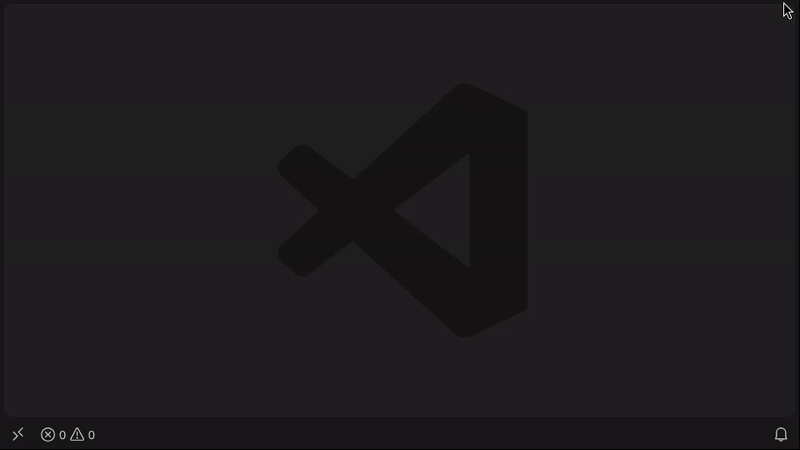
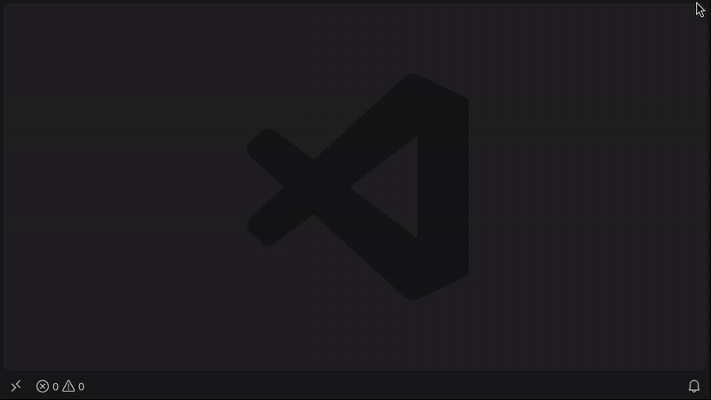
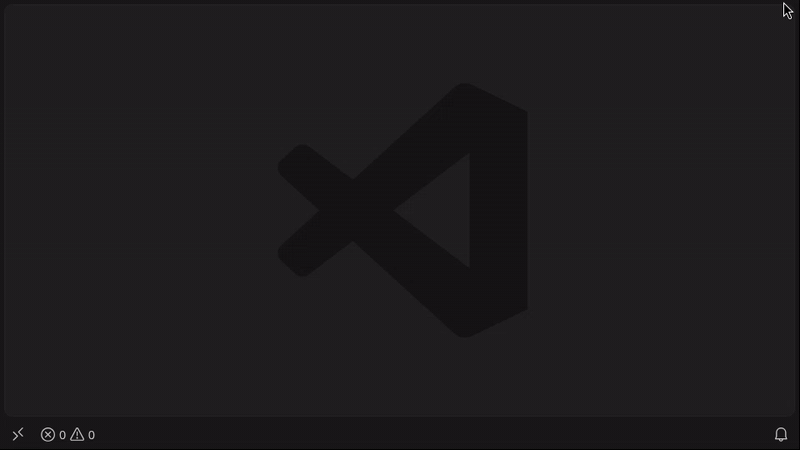
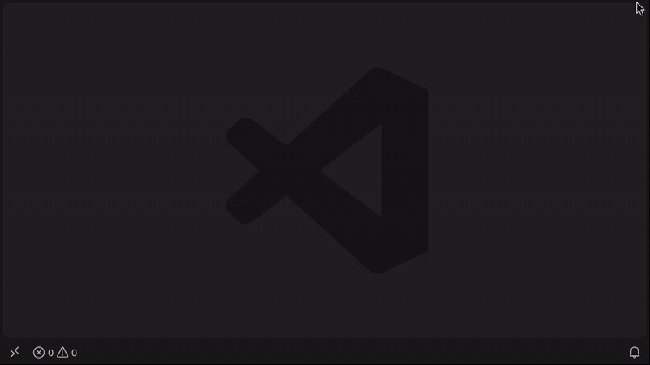
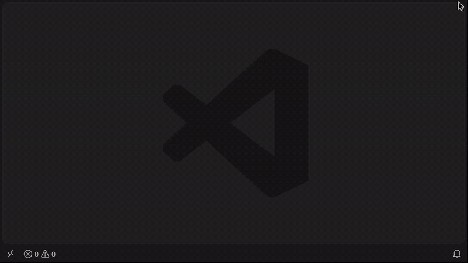
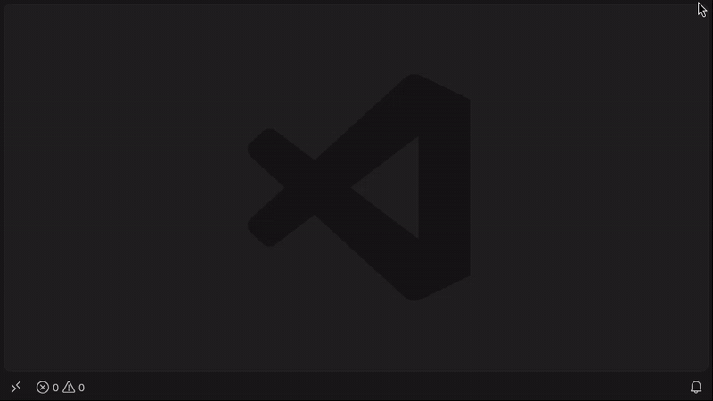
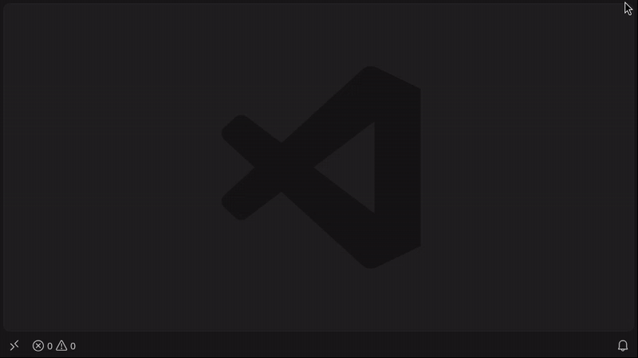

# Demos

Short recordings of each feature. The README shows the hover, the explanation panel and following
the cursor; the rest are here. Each loop is one idea, recorded at the size it is shown.

The GIFs are recorded by the scripts in `packages/vscode-regex-explain/demo/`, which are listed in
[`COVERAGE.md`](../packages/vscode-regex-explain/demo/COVERAGE.md) next to the feature each one
shows.

## Finding regexes

### In code, passed to a regex API

A pattern in a string passed to a regex API is found too, here `re.compile` in Python.

### In other languages

The same hover in Go, Rust, Java, C#, Ruby and PHP. The regex is found by parsing the file, so the
call that holds it decides what is explained.

### Any selected text

Select a pattern in any file, here a plain text file, then hover the selection.

## Backtracking warnings

### A catastrophic pattern

A pattern that can backtrack catastrophically gets a warning at the top of its hover.

### Turning the warning off

Turn off `regexExplain.checkBacktracking` and the warning goes away; the explanation stays.

## Opening the panel

### From the context menu

Right-click in the editor and choose **Regex Explain: Explain Regex**.

### With no regex under the cursor

When nothing is selected and the cursor is not in a regex, the command asks for a pattern to
explain.

## Settings

### Hover explanations on and off

`regexExplain.hover.enabled` turns the hover off and back on.

### One language only

Every setting can be set for a single language. Here hover is off for Python and still on in
TypeScript.

### Keeping the panel on its regex

Turn off `regexExplain.panel.follow` and the panel keeps its regex while the cursor moves to
another.

